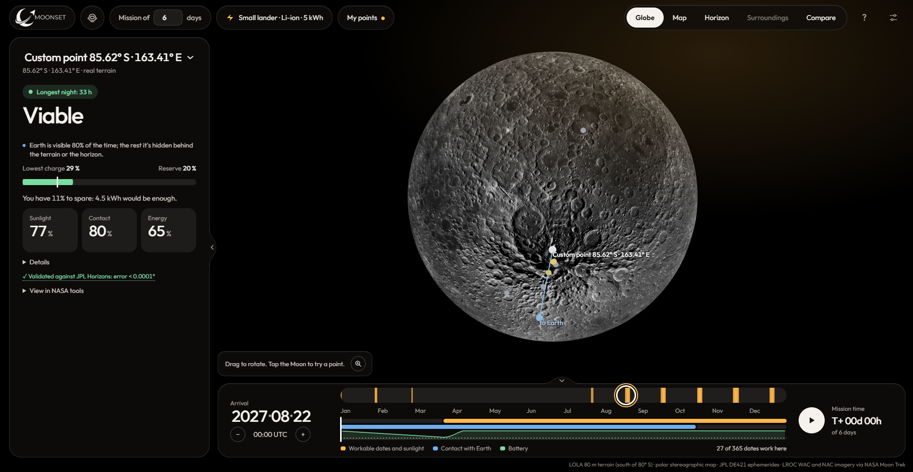
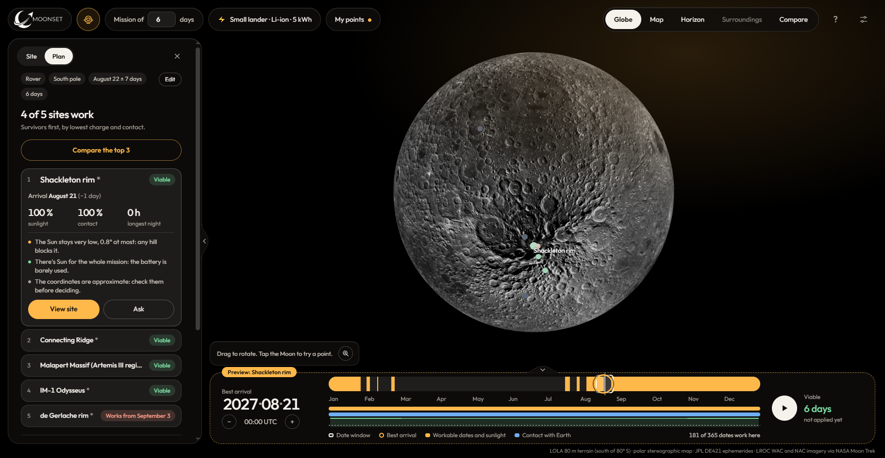
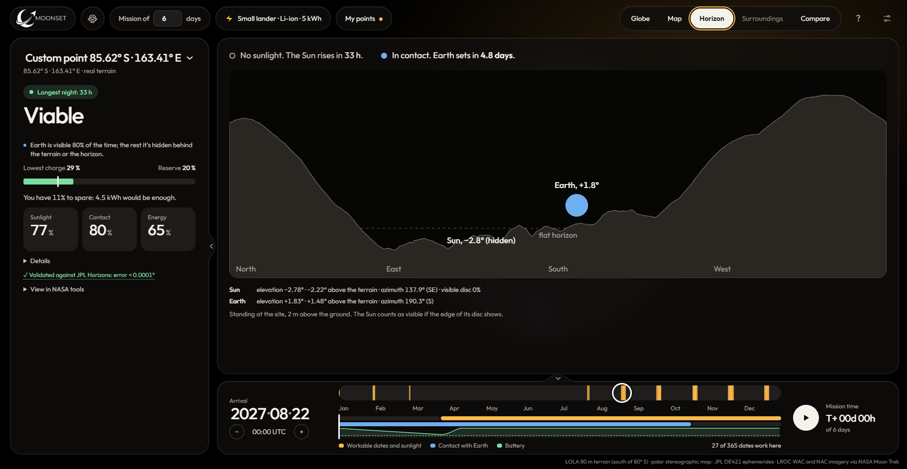
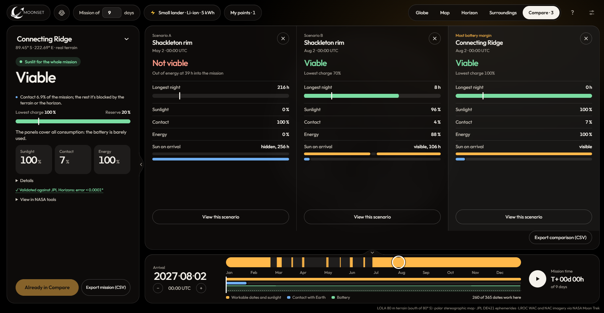

# MoonSet

**Know when the Sun and Earth set, anywhere on the Moon.**

MoonSet es una herramienta web para elegir dónde y cuándo alunizar. Para cualquier punto de la Luna y cualquier
día de 2027 calcula cuándo hay Sol sobre el relieve real (energía para los paneles) y cuándo se ve la Tierra
(comunicación directa), y simula la batería de la misión para decir si sobrevive la noche lunar.

Proyecto para el **NASA Space Apps Challenge 2026**, desafío *Lunar Landing Site Navigator*.

- **App publicada:** https://moon-set.vercel.app
- **Video:** <!-- VIDEO: reemplazar por el enlace del video --> _enlace pendiente_

## Qué podés hacer

Al entrar elegís un perfil: **Explorar** (lo esencial, en lenguaje simple) o **Planificar** (todas las vistas y
cifras). La interfaz está en español e inglés, y un tutorial guiado presenta cada parte la primera vez.

- **Explorar la Luna.** Un globo 3D con 25 sitios (Apollo, Artemis, CLPS y misiones de China, India, Japón, Israel
  y Rusia, incluidas algunas que se estrellaron) y un mapa del polo sur, coloreados según si la misión es viable en la fecha elegida. Al tocar un sitio, el panel dice si la
  misión es viable o inviable, cuánta luz y cuánto contacto con la Tierra tiene, y por qué. Con el backend se puede probar cualquier
  punto propio.
- **Planificar con el astronauta.** Cuatro preguntas (qué llevás, dónde, cuándo ± cuántos días, cuánto dura) y un
  ranking de sitios con la mejor llegada de cada uno, explicaciones con números y preguntas rápidas ("¿y si llego
  una semana después?", "¿cuánta batería necesito?"). Funciona con reglas sobre los mismos cálculos de la app, sin IA.
- **Horizonte.** El panorama de 360° desde el sitio, con el relieve, el Sol y la Tierra en la hora elegida.
- **Alrededores.** La misma misión a pocos cientos de metros, en una grilla de 11 × 11 puntos alrededor de los
  sitios polares.
- **Comparar.** Hasta 4 escenarios (sitio y fecha) lado a lado.
- **Línea de tiempo.** El año con las fechas que sirven y, dentro de la misión, la luz, el contacto y la batería hora
  por hora.
- **Exportar CSV.** La misión hora por hora o la comparación de escenarios (formato en
  [Leer los CSV exportados](#leer-los-csv-exportados)).
- **Herramientas de NASA.** Abre NASA Moon Trek y LROC QuickMap centrados en el sitio, y las tablas de JPL Horizons
  del Sol y la Tierra para las horas de la misión.

<!-- CAPTURAS: agregar los archivos en docs/capturas/ con estos nombres. -->





## Cómo funciona

1. **Sol y Tierra en el cielo.** Con skyfield, las efemérides JPL DE421 y la orientación real de la Luna (marco
   `MOON_ME`, que incluye la libración), se calcula la elevación y el azimut del Sol y la Tierra desde cada sitio,
   hora por hora durante 2027.
2. **Relieve del horizonte.** Se trazan rayos sobre el DEM de LOLA de 80 m (hasta 250 km, a 2 m del suelo) y se
   obtiene la altura del horizonte en cada una de las 360 direcciones. Fuera del DEM se usa la esfera lisa.
3. **Luz y contacto.** Hay luz si asoma el borde del disco solar sobre el relieve; hay contacto si el centro de la
   Tierra está sobre el relieve (con un margen mínimo opcional para la antena).
4. **Energía.** Se simula la batería hora por hora: paneles, consumo de día y de noche, calefacción, eficiencia,
   autodescarga y reserva. La misión sobrevive si la batería nunca baja de la reserva.
5. **Dónde corre.** Los 25 sitios están precalculados en JSON (`data/anual/`) y las métricas se calculan en el
   navegador: cambiar la fecha, la duración o la batería es instantáneo y no hace falta servidor. El backend
   (FastAPI) solo se usa para coordenadas propias (`GET /anual?lat=&lon=`).

```
data/sitios.json ─► backend/scripts (skyfield + DE421, DEM LOLA) ─► data/anual/*.json ─► frontend (React + Vite)
                    backend FastAPI: GET /anual?lat=&lon= ──────────────────────────────► puntos propios
```

- `backend/`: cálculo y API. Ver [backend/README.md](backend/README.md).
- `frontend/`: interfaz. Ver [frontend/README.md](frontend/README.md).
- `data/`: lista curada de sitios y resultados precalculados.
- `docs/`: [estado del proyecto](docs/ESTADO.md) y [validación](docs/VALIDACION.md).

## Validación

Las posiciones del Sol y la Tierra se compararon con **JPL Horizons** (efemérides DE441, marco lunar `MEAN_ME`) en
los 13 sitios que tenía el catálogo al validar, en 5 instantes repartidos en 2027 (los 12 sitios sumados después
todavía no se validaron; se agregan corriendo de nuevo `validar_horizons.py`). El error máximo es de **0,00006° en azimut y 0,00001° en
elevación**, frente a un umbral de 0,05°; ningún caso lo supera. La tabla completa está en
[docs/VALIDACION.md](docs/VALIDACION.md) y se regenera con `backend/scripts/validar_horizons.py`. En la app, el sello
"Validado contra JPL Horizons" abre una página propia con el resumen y las tablas en es/en
([moon-set.vercel.app/validacion.html](https://moon-set.vercel.app/validacion.html)), que
`frontend/scripts/generar-validacion.mjs` arma desde `data/validacion/horizons.json` en cada build.

Las métricas derivadas (porcentaje de luz, noche más larga, contacto) todavía no se cruzaron con fuentes
publicadas. La lógica tiene tests automáticos: `pytest` en `backend/` y `npm test` en `frontend/` (energía,
planificador, explicaciones, exportación, enlaces).

## Limitaciones

- **Relieve real solo al sur de 80° S.** El DEM de LOLA de 80 m cubre de 80° S al polo: 6 de los 25 sitios (IM-1,
  IM-2, Connecting Ridge, Macizo Malapert y los bordes de Shackleton y de Gerlache). Los otros 19, y cualquier punto
  más al norte, usan la esfera lisa, y el panel lo
  indica ("sin relieve"). Cerca de 80° S el relieve solo cubre hacia el polo.
- **Solo 2027.** Los datos y las fechas de llegada son de ese año.
- **Coordenadas aproximadas.** Connecting Ridge, Macizo Malapert, los bordes de Shackleton y de Gerlache, IM-3 (todavía
  no alunizó) y Hakuto-R M2 están marcados para verificar contra una fuente oficial; la app lo avisa.
- **Sitios de impacto.** Hakuto-R M1 y M2, Chandrayaan-2 Vikram, Luna-25 y Beresheet se estrellaron. Están en la lista
  para comparar, y se calculan como si una misión alunizara ahí.
- **Perfiles de batería de ejemplo.** Módulo chico, rover y base usan valores de ejemplo, no de misiones reales.
  Se pueden ajustar todos los campos.
- **Alrededores** solo para los 4 sitios al sur de 85° S, con la posición del Sol del sitio central.
- **Imágenes del globo.** El mosaico es una foto promedio: sus sombras no son las de la fecha elegida.
- **Puntos propios** solo con el backend encendido; sin él la app funciona con los 25 sitios precalculados.

## Recursos usados

### Datos e imágenes

| Recurso | Para qué | Fuente |
|---|---|---|
| LOLA LDEM_80S_80M, DEM del polo sur a 80 m/píxel | Horizonte con relieve, mapa 2D del polo | NASA LRO / LOLA, PDS ([imbrium.mit.edu](https://imbrium.mit.edu/DATA/LOLA_GDR/POLAR/IMG/)) |
| Efemérides planetarias DE421 (`de421.bsp`) | Posición del Sol y la Tierra | NASA JPL |
| Kernels SPICE de la Luna (`moon_080317.tf`, `moon_pa_de421_1900-2050.bpc`, `pck00008.tpc`) | Orientación de la Luna y libración | NASA JPL / NAIF |
| JPL Horizons (API) | Validación y enlaces desde el panel | [NASA JPL SSD](https://ssd.jpl.nasa.gov/horizons/) |
| Mosaico global LROC WAC (`LRO_WAC_Mosaic_Global_303ppd_v02`) | Globo 3D y textura local | NASA / GSFC / Arizona State University, vía [NASA Moon Trek](https://trek.nasa.gov/moon/) |
| Mosaico LROC NAC del polo sur (`LRO_NAC_AvgMosaic_SPole855_1mp`) | Detalle del globo cerca del polo | NASA / GSFC / Arizona State University, vía NASA Moon Trek |
| NASA Moon Trek | Teselas del globo y enlaces al sitio | NASA Solar System Treks |
| LROC QuickMap | Enlaces al sitio | [LROC, Arizona State University](https://quickmap.lroc.im-ldi.com/) |
| Blue Marble Next Generation | La Tierra en la pantalla de inicio | NASA Earth Observatory |
| Coordenadas de los sitios | `data/sitios.json` | Ver la lista de abajo |

Coordenadas de los sitios (cada una está también en el campo `fuente` de `data/sitios.json`):

- Apollo 11, 12, 14, 15, 16 y 17: NASA, coordenadas de los módulos lunares.
- IM-1 Odysseus: NASA / LROC, [USRA LEAG 2024](https://www.hou.usra.edu/meetings/leag2024/presentations/Tuesday/1445_Gruener.pdf).
- IM-2 Athena: LROC / [Orrery Space](https://orreryspace.com/landing-sites/im2/).
- IM-3: NASA PRISM / JHU APL, [LPSC 2025](https://www.hou.usra.edu/meetings/lpsc2025/pdf/1233.pdf) (sitio previsto).
- Firefly Blue Ghost M1: [LROC / NASA / ASU, imagen 1407](https://lroc.im-ldi.com/images/1407).
- Chang'e 3: [LROC / NASA / ASU, imagen 938](https://lroc.im-ldi.com/images/938).
- Chang'e 4: Liu et al., *Nature Communications* 2019 (LROC NAC).
- Chang'e 5: Wang et al., *Remote Sensing* 2021, [LROC NAC DOM](https://www.mdpi.com/2072-4292/13/4/590).
- Chang'e 6: [LROC / NASA / ASU, imagen 1374](https://lroc.im-ldi.com/images/1374).
- Chandrayaan-3: [LROC / NASA / ASU, imagen 1314](https://lroc.im-ldi.com/images/1314).
- Chandrayaan-2 Vikram: [NASA / LROC](https://www.nasa.gov/image-article/vikram-lander-found/).
- JAXA SLIM: [NASA / LROC](https://www.nasa.gov/missions/lro/nasas-lro-spots-japans-moon-lander/).
- ispace Hakuto-R M1: NASA / LROC, vía [Wikipedia](https://en.wikipedia.org/wiki/Hakuto-R_Mission_1).
- ispace Hakuto-R M2 Resilience: [ispace / NASA LRO](https://www.nasa.gov/missions/lro/nasas-lro-views-ispace-hakuto-r-mission-2-moon-lander-impact-site/).
- Luna-25: [NASA / LROC](https://www.nasa.gov/humans-in-space/nasas-lro-observes-crater-likely-from-luna-25-impact/).
- SpaceIL Beresheet: [LROC / NASA / ASU, imagen 1101](https://lroc.im-ldi.com/images/1101).
- Connecting Ridge, Macizo Malapert y los bordes de Shackleton y de Gerlache: puntos elegidos sobre el DEM de LOLA
  (Malapert, dentro de la zona LROC MALAPERTLOD).

Opcional, no usado en la versión publicada: el mosaico LOLA de 5 m/píxel del polo
([pgda.gsfc.nasa.gov/products/81](https://pgda.gsfc.nasa.gov/products/81)), que el backend lee si está.
No se usaron datos de la Agencia Espacial Canadiense (CSA).

### Librerías

| Librería | Para qué | Licencia |
|---|---|---|
| [Skyfield](https://rhodesmill.org/skyfield/) (con jplephem y sgp4) | Efemérides | MIT |
| [FastAPI](https://fastapi.tiangolo.com/) y Starlette | API | MIT / BSD-3-Clause |
| [Uvicorn](https://www.uvicorn.org/) | Servidor | BSD-3-Clause |
| [Pydantic](https://docs.pydantic.dev/) | Validación de pedidos | MIT |
| [NumPy](https://numpy.org/) | Cálculo numérico | BSD-3-Clause |
| [SciPy](https://scipy.org/) | Interpolación sobre el DEM | BSD-3-Clause |
| [rasterio](https://rasterio.readthedocs.io/) y [pyproj](https://pyproj4.github.io/pyproj/) | Lectura del DEM de 5 m (opcional) | BSD-3-Clause / MIT |
| [Pillow](https://python-pillow.org/) | Scripts que generan las texturas y el mapa | MIT-CMU |
| [pytest](https://pytest.org/) y [HTTPX](https://www.python-httpx.org/) | Tests del backend | MIT / BSD-3-Clause |
| [React](https://react.dev/) y React DOM | Interfaz | MIT |
| [three.js](https://threejs.org/) | Globo 3D y pantalla de inicio | MIT |
| [React Three Fiber](https://github.com/pmndrs/react-three-fiber) y [Drei](https://github.com/pmndrs/drei) | three.js con React | MIT |
| [Vite](https://vite.dev/) y @vitejs/plugin-react | Desarrollo y build | MIT |
| Outfit, Saira Semi Condensed, IBM Plex Sans e IBM Plex Mono, vía Google Fonts | Tipografías | SIL Open Font License 1.1 |

Versiones exactas en `backend/requirements.txt` y `frontend/package.json`. Publicación: Vercel (frontend) y Google
Cloud Run (backend, https://moonset-api-253573052051.southamerica-east1.run.app).

### Inteligencia artificial

Durante el desarrollo usamos **Claude** (Anthropic): en el chat, para investigar el desafío, planificar la
arquitectura, prototipar ideas (como el planificador del astronauta) y redactar documentación; y **Claude Code**, para
escribir y revisar código, tests y documentación. El equipo definió qué construir, tomó las decisiones de diseño y
revisó cada cambio. La app no usa IA en tiempo de ejecución: el asistente del astronauta funciona con reglas sobre los
cálculos de la propia app.
<!-- Agregar acá cualquier otra herramienta de IA que se haya usado (texto, imágenes, video). -->

## Correr en local

Requisitos: Python 3.11+ y Node 18+.

**Solo la interfaz (sin backend).** Usa los 25 sitios precalculados que ya están en `data/`:

```bash
cd frontend
npm install
npm run dev                     # http://localhost:5173
```

**Con backend** (habilita puntos propios: coordenadas libres en `GET /anual?lat=&lon=`):

```bash
# Terminal 1 — backend
cd backend
python -m venv .venv
source .venv/bin/activate       # Windows: .venv\Scripts\activate
pip install -r requirements.txt
python scripts/descargar_datos.py          # kernels JPL (~18 MB) y DEM LOLA 80 m (115 MB)
uvicorn app.main:app --reload              # http://127.0.0.1:8000/docs

# Terminal 2 — frontend
cd frontend
echo "VITE_API_URL=http://127.0.0.1:8000" > .env
npm install
npm run dev
```

Para una demo, corré el backend sin `--reload` (`uvicorn app.main:app`). Al arrancar carga los kernels, scipy y
el DEM de `data/raw` (unos segundos, lo muestra en la consola) para que el primer punto no espere; con `--reload`
cada cambio de archivo reinicia el proceso y se pierde eso.

Si los puertos 8000/5173 están ocupados, usá otros: `uvicorn ... --port 8010`, `npm run dev -- --port 5174`.
En desarrollo el backend acepta cualquier puerto de `localhost`/`127.0.0.1`. En producción, fijá los orígenes
permitidos con `MOONSET_CORS` (por ejemplo `MOONSET_CORS="https://moonset.ejemplo.org"`): si está definida,
solo se aceptan esos.

`npm run dev` y `npm run build` copian `data/precalculado` y `data/anual` a `frontend/public/` solos.

### Regenerar datos (opcional)

Los resultados ya están commiteados. Solo hace falta si cambian los sitios o el algoritmo:

```bash
cd backend
python scripts/precalcular_sitios.py     # horizonte y métricas por sitio
python scripts/precalcular_anual.py      # año 2027, cada hora, Sol/Tierra por sitio
python scripts/precalcular_vecindad.py   # grillas de alrededores (sitios polares)
python scripts/generar_mapa_polo.py      # fondo del mapa 2D del polo sur (usa el DEM si está)
node ../frontend/scripts/copiar-datos.mjs
```

Para el relieve real al sur de 80°S hace falta el DEM de LOLA de 80 m (115 MB) en `data/raw/`.
`python scripts/descargar_datos.py` lo baja junto con los kernels (con `--sin-dem`, solo los kernels).

Sin ese archivo el horizonte se calcula sobre la esfera lisa (sin relieve). Tests: `cd backend && pytest`.

Con el DEM descargado, `python scripts/generar_mapa_polo.py` reemplaza el fondo del mapa 2D (que viene
de la textura LROC, en baja resolución) por el relieve sombreado de LOLA a 80 m. Después hay que commitear
`data/mapa/polo_sur.jpg` y `data/mapa/polo_sur.json`.

### Leer los CSV exportados

"Exportar misión (CSV)", en el panel del sitio, descarga la misión elegida con una fila por hora (Sol, Tierra, luz,
contacto, energía y batería, fechas en UTC) y los datos del sistema arriba. "Exportar comparación (CSV)", en la vista
Comparar, descarga una fila por escenario fijado. Con la interfaz en castellano el separador es ";" y la coma decimal
(Excel en castellano lo abre con doble clic); en inglés, "," y punto decimal. Los nombres de columna no cambian. Se arma
en `frontend/src/v2/exportar.js`.

Las líneas del principio que empiezan con `#` son metadatos (sitio, coordenadas, perfil, batería, criterio de luz y
contacto…), no datos: después viene el encabezado y una fila por hora o por escenario. Para leerlo en Python, se
saltean con `comment="#"`, y `encoding="utf-8-sig"` quita la marca BOM del principio (la que pone el
archivo para que Excel lea bien los acentos):

```python
import pandas

pandas.read_csv(archivo, sep=";", decimal=",", comment="#", encoding="utf-8-sig")  # interfaz en castellano
pandas.read_csv(archivo, sep=",", comment="#", encoding="utf-8-sig")               # interfaz en inglés
```

## Equipo

- Ricardo Argüello
- Simon Ordeig
- Leonardo Frey
- Maximiliano Cristaldo

## Licencia

MIT

## Deploy

El frontend es estático y el backend es opcional: sin backend la página funciona con los 25 sitios
precalculados; con backend se suman los puntos propios (`GET /anual`).

### Frontend en Vercel

- Proyecto con **Root Directory** `frontend`, framework **Vite** (build `npm run build`, salida `dist`).
- Variable de entorno **`VITE_API_URL`** con la URL del backend, sin barra final
  (la publicada usa `https://moonset-api-253573052051.southamerica-east1.run.app`). Se lee en el build: después de
  cambiarla hay que volver a desplegar. Vacía o sin definir, la app queda en modo estático.
- Publicado en https://moon-set.vercel.app.

### Backend en Google Cloud Run

Publicado en https://moonset-api-253573052051.southamerica-east1.run.app (1 GiB, siempre encendido con `--min-instances 1`).

`backend/Dockerfile` (Python 3.12 slim) instala las dependencias y, en el build, baja los kernels de JPL y el DEM
LOLA 80 m con `scripts/descargar_datos.py`: quedan dentro de la imagen y el contenedor no descarga nada al
arrancar. Escucha en `$PORT` (8000 si no está), corre sin `--reload`, como usuario sin privilegios, y no escribe
en disco (solo podría usar `/tmp`). Desde la raíz del repo:

```bash
gcloud run deploy moonset-api --source backend --region southamerica-east1   --memory 1Gi --cpu 1 --min-instances 1 --allow-unauthenticated   --set-env-vars MOONSET_CORS=https://moon-set.vercel.app
```

- `MOONSET_CORS` es la lista exacta de orígenes permitidos, separada por comas (las vistas previas de Vercel,
  `moon-set-git-….vercel.app`, no entran si no se agregan). Sin la variable solo se acepta `localhost`.
- Memoria: unos 500 MB con el DEM cargado y después de varios pedidos; entra en 1 GiB.
- **`--min-instances 1` evita que se duerma, pero consume crédito todo el tiempo.** Configurá una alerta de
  presupuesto en Billing → Budgets & alerts antes de dejarlo andando. Con `--min-instances 0` es gratis en reposo,
  pero el primer pedido después de un rato espera el arranque (unos segundos más el precalentado).
- La imagen solo ve la carpeta `backend/`: por eso lleva una copia de `data/sitios.json` en
  `backend/datos/sitios.json`. Si cambia la lista, copiala (`pytest` avisa si quedaron distintas).

Probar la imagen en local (con Docker):

```bash
docker build -t moonset-api backend
docker run --rm -p 8000:8000 --read-only --tmpfs /tmp -e MOONSET_CORS=https://moon-set.vercel.app moonset-api
curl http://localhost:8000/salud
curl "http://localhost:8000/anual?lat=-89.45&lon=222.69" -o /dev/null -w "%{http_code} %{size_download}
"
```

### Alternativa sin tarjeta: Render

Un **Web Service** de tipo Docker con el mismo `Dockerfile` (Root Directory `backend`), la variable
`MOONSET_CORS=https://moon-set.vercel.app` y Health Check Path `/salud`. Render pasa el puerto en `$PORT`.
El plan gratis duerme el servicio tras unos minutos sin pedidos: para evitarlo, un monitor externo (por ejemplo
UptimeRobot o cron-job.org) que llame a `https://<servicio>.onrender.com/salud` cada 10 minutos.
**Ojo con la memoria:** con 512 MB el backend se queda sin memoria por el DEM (unos 230 MB solo el DEM, unos
500 MB en total). Hace falta un plan de al menos 1 GB. Con menos, se puede arrancar sin el DEM (`MOONSET_DEM_80S=/no-existe`), pero los
puntos propios al sur de 80° S se calculan sin relieve.
